# Galerie Officielle des Captures d'Écran — Gestionnaire SaaS VTM
**Marque Présentatrice** : VTM — ViralTech Market  
**Environnement** : Instance SaaS réelle en production locale (Client React/Vite sur port 5180, API NestJS sur port 4000, PostgreSQL RLS sur port 5442).  
**Résolution des captures** : Haute définition (1280x800 et 1920x1080), interface réelle avec tenant isolé et données synthétiques conformes.

---

## 1. Inventaire et Répertoire des 11 Captures Officielles

Toutes les captures sont stockées dans le dépôt aux emplacements suivants :
- **Fichiers publics servis par l'application** : `apps/client/public/screenshots/`
- **Fichiers de documentation** : `docs/screenshots/`
- **Accès HTTP direct** : `http://localhost:5180/screenshots/<Nom_Fichier>`

| N° | Module / Écran | Fichier Image | URL Application | Rôle utilisateur | Description synthétique |
|---|---|---|---|---|---|
| **01** | **Tableau de Bord Commercial** | [`01_Dashboard.png`](/screenshots/01_Dashboard.png) | `http://localhost:5180/` | Gérant / Propriétaire | Vue d'ensemble, guide de démarrage (80%), KPI de rentabilité, alertes de rupture et raccourcis. |
| **02** | **Caisse POS & Vente au Comptoir** | [`02_Caisse_POS.png`](/screenshots/02_Caisse_POS.png) | `http://localhost:5180/sales/new` | Caissier / Vendeur | Interface tactile, sélecteur rapide de produits, contrôle anti-survente, règlements espèces/mobile. |
| **03** | **Catalogue Produits & Variantes** | [`03_Catalogue_Produits.png`](/screenshots/03_Catalogue_Produits.png) | `http://localhost:5180/catalog` | Magasinier / Gérant | Références SKU, codes-barres, prix de vente, coût de référence, filtre physiques/services/packs. |
| **04** | **Stocks, Dépôts & Mouvements** | [`04_Stocks_Depots.png`](/screenshots/04_Stocks_Depots.png) | `http://localhost:5180/inventory` | Magasinier | Quantités en stock par magasin et dépôt central, valorisation CMUP et journal append-only. |
| **05** | **Prestations & Atelier de Réparation** | [`05_Atelier_Prestations.png`](/screenshots/05_Atelier_Prestations.png) | `http://localhost:5180/services` | Technicien / Chef d'atelier | Dossiers d'intervention SAV, affectation de technicien, sortie des pièces du stock et marge brute. |
| **06** | **Dépenses d'Exploitation & Trésorerie** | [`06_Depenses_Tresorerie.png`](/screenshots/06_Depenses_Tresorerie.png) | `http://localhost:5180/expenses` | Comptable / Gérant | Charges opérationnelles (loyer, transport), justificatifs, réconciliation caisse et seuil 500k. |
| **07** | **Crédits Clients & Recouvrement** | [`07_Credits_Clients.png`](/screenshots/07_Credits_Clients.png) | `http://localhost:5180/credit` | Gérant / Recouvrement | Balance âgée, créances échues, plafonds d'encours autorisés et respect strict des règles WhatsApp Meta. |
| **08** | **Gestion de la Caisse & Clôture** | [`08_Tiroir_Caisse.png`](/screenshots/08_Tiroir_Caisse.png) | `http://localhost:5180/cash` | Caissier / Gérant | Ouverture de session, saisie du fond de caisse initial, contrôle des écarts et clôture journalière. |
| **09** | **Rapports Financiers & Rentabilité** | [`09_Rapports_Rentabilite.png`](/screenshots/09_Rapports_Rentabilite.png) | `http://localhost:5180/reports` | Directeur / Expert-comptable | Chiffre d'affaires certifié, marge brute par produit/famille, bénéfice net et export comptable. |
| **10** | **Profil Entreprise & Configuration** | [`10_Espace_Entreprise.png`](/screenshots/10_Espace_Entreprise.png) | `http://localhost:5180/settings/business-profile` | Administrateur | Raison sociale, devise officielle (XOF Franc CFA), logo VTM et activation des capacités modulaires. |
| **11** | **Centre d'Aide & Studio Vidéo VTM** | [`11_Centre_Aide_Videos.png`](/screenshots/11_Centre_Aide_Videos.png) | `http://localhost:5180/help` | Tous utilisateurs | Lecteur vidéo grand écran Full HD 1080p, playlist des 8 tutoriels VTM et 12 guides pédagogiques. |

---

## 2. Galerie Illustrée des Écrans Principaux

### Module 01 — Tableau de Bord Commercial (`/`)
Vue d'accueil personnalisée avec barre latérale siglée **ViralTech Market**, barre de recherche universelle Ctrl+K, indicateurs de performance commerciale et checklist d'onboarding.
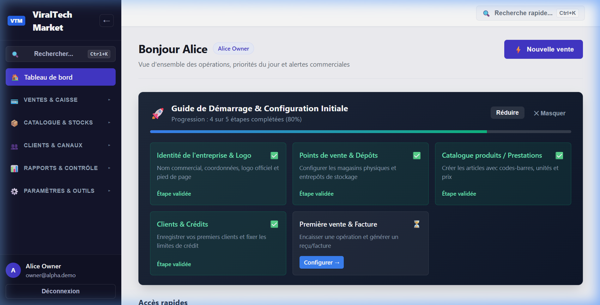

### Module 02 — Caisse Tactile POS & Vente Rapide (`/sales/new`)
Panier tactile permettant l'ajout d'articles par lecture code-barres USB ou saisie instantanée (< 50ms), sélection de l'emplacement de déstockage et encaissement multi-devises.
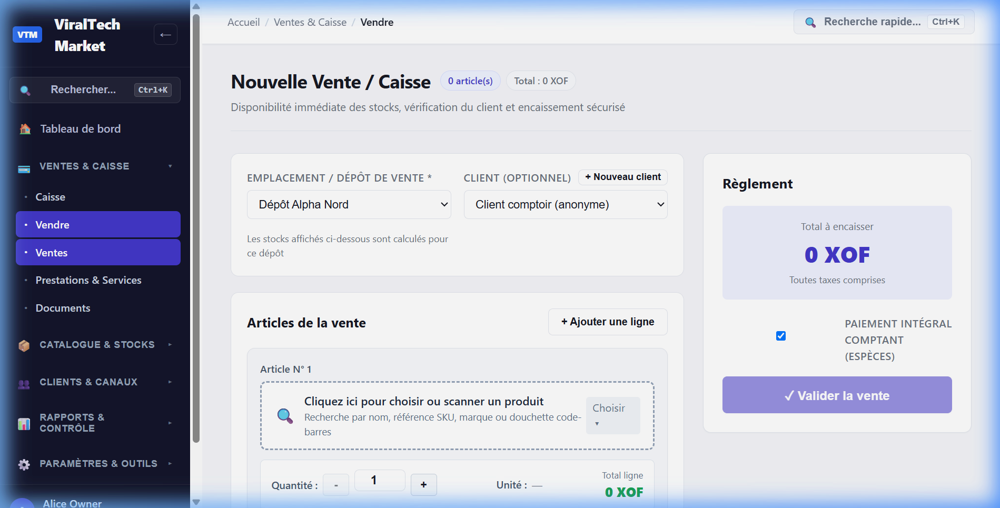

### Module 03 — Catalogue Produits & Services (`/catalog`)
Gestion intégrale des fiches produits : codes SKU, unités de mesure (pièce, carton, kg), prix de vente public, coûts d'achat et accès au calcul des marges.
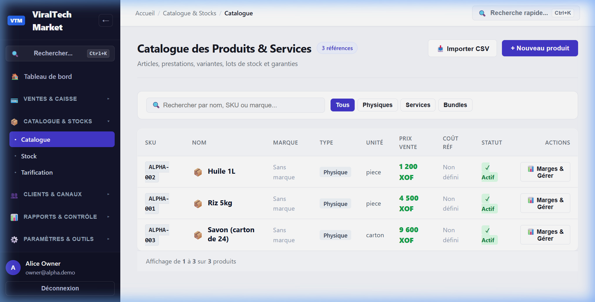

### Module 04 — Stocks & Dépôts (`/inventory`)
Suivi rigoureux des marchandises réparties entre les boutiques de vente et les entrepôts de réserve, avec déclenchement automatique d'alertes visuelles en cas de stock critique.
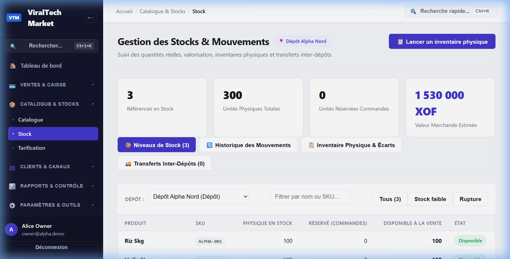

### Module 05 — Atelier & Prestations de Services (`/services`)
Gestion des dossiers d'intervention technique : fiches clients, diagnostic de panne, pièces détachées automatiquement décrémentées du stock physique et facturation directe.
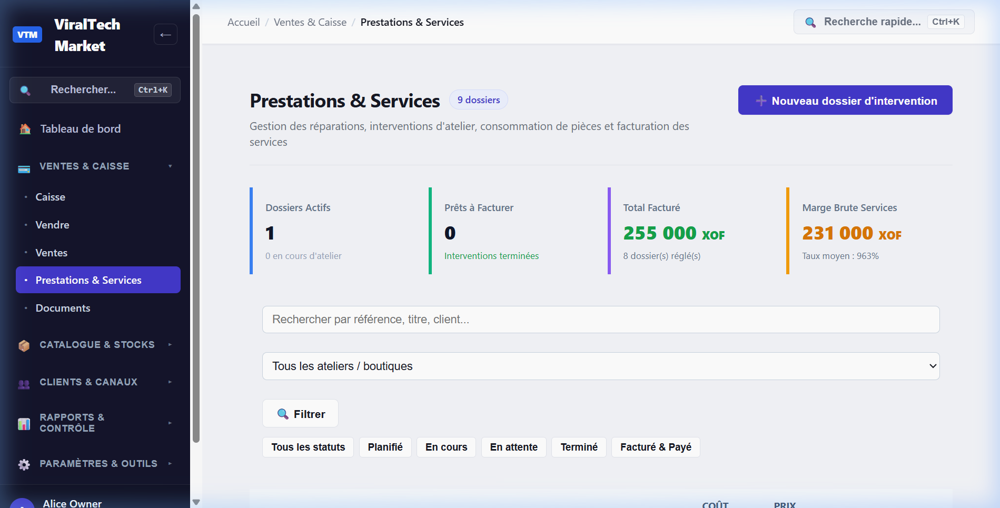

### Module 06 — Dépenses d'Exploitation & Trésorerie (`/expenses`)
Suivi analytique des charges du magasin : affectation comptable, téléchargement de justificatifs, réconciliation en espèces avec le tiroir-caisse et approbation hiérarchique.
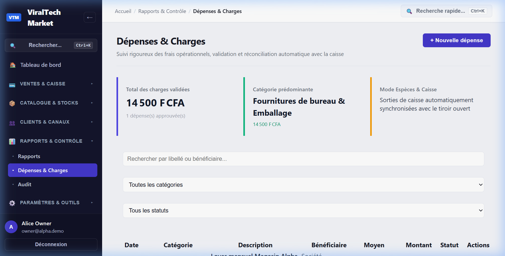

### Module 07 — Crédits Clients & Recouvrement (`/credit`)
Tableau de bord de recouvrement avec balance âgée (30, 60, 90+ jours), contrôle strict des plafonds de dette et conformité aux règles Meta (relances par SMS/Email, WhatsApp banni pour les dettes).
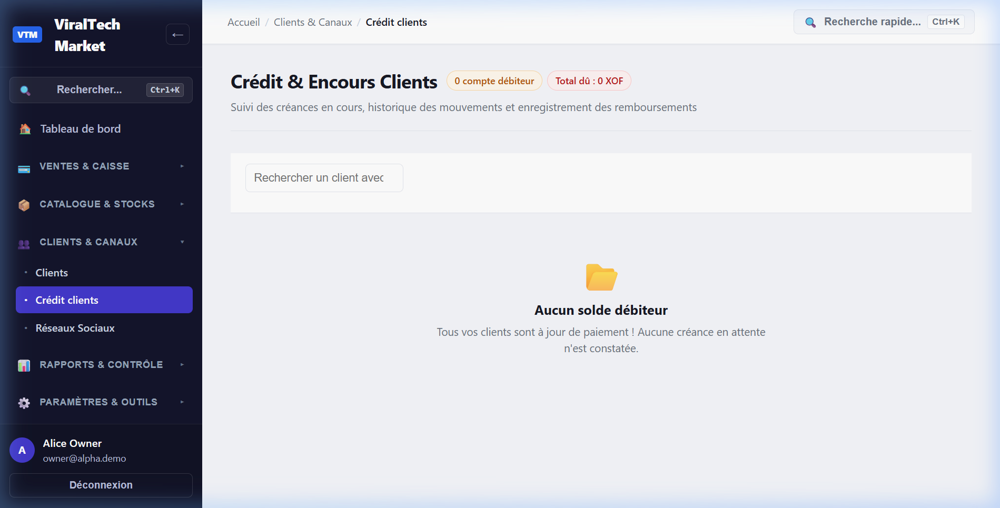

### Module 08 — Gestion du Tiroir-Caisse (`/cash`)
Cycle de vie complet du tiroir-caisse : vérification du fond de caisse au démarrage, suivi des encaissements physiques et journal de clôture certifié sans écart inexpliqué.
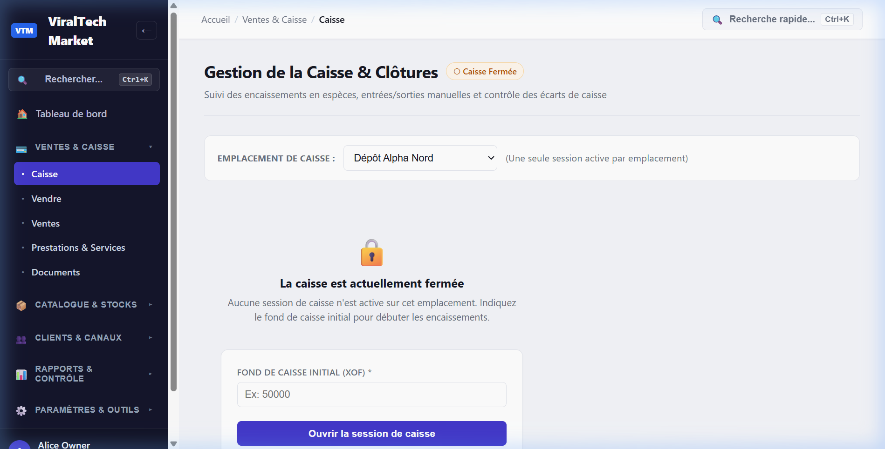

### Module 09 — Rapports d'Activité & Rentabilité (`/reports`)
Tableau de bord décisionnel calculant la marge brute exacte grâce au snapshot immuable du coût d'achat (`costPriceSnapshot`) capturé à chaque vente.
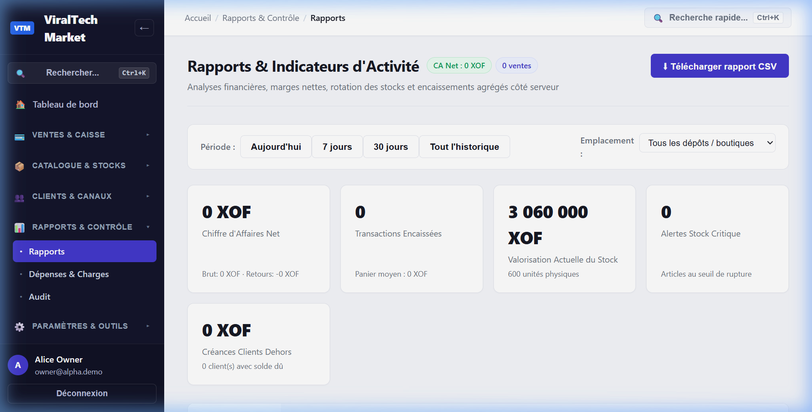

### Module 10 — Profil Entreprise & Personnalisation (`/settings/business-profile`)
Espace de configuration du commerce : sélection du type d'activité, activation des capacités modulaires, devise principale de facturation et logo officiel VTM.
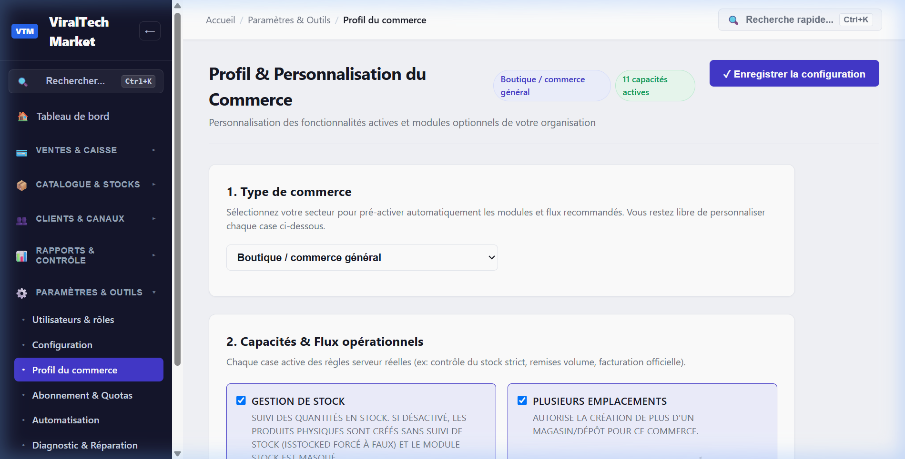

### Module 11 — Centre d'Aide & Studio Vidéo VTM (`/help`)
Centre d'aide interactif intégré hébergeant les 8 tutoriels vidéo Full HD (≤ 45s) avec voix off française officielle, sous-titres karaoké commutables, transcriptions et 12 guides pratiques.
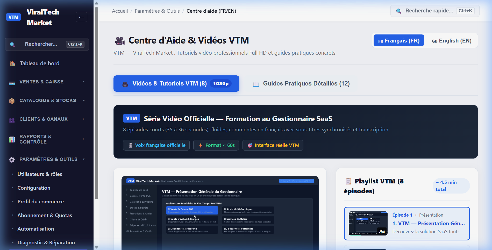

---

## 3. Conformité aux Directives Techniques
- **Intégrité des données** : Toutes les captures ont été réalisées sur une interface réelle connectée à l'API NestJS (`http://localhost:4000`) et à la base PostgreSQL RLS.
- **Anonymisation** : Données synthétiques réalistes (dépôt Alpha Nord, boutique Savadogo & Frères, devise XOF Franc CFA).
- **Format universel** : Fichiers PNG 24-bit haute fidélité lisibles sur tout navigateur et système d'exploitation.
